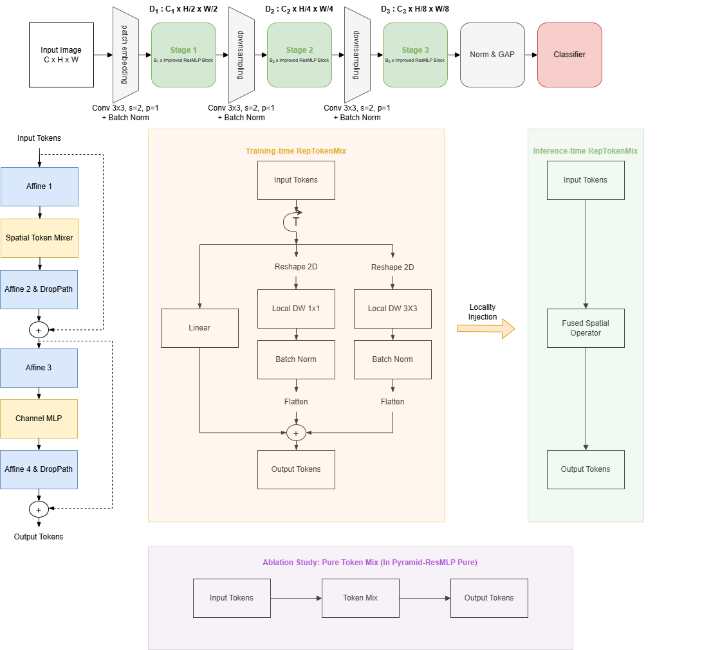
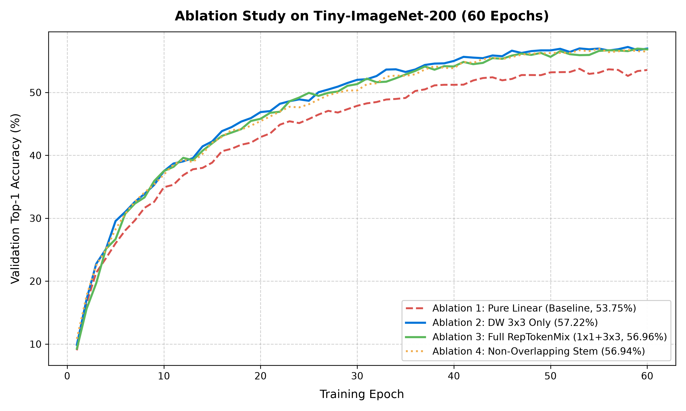

# Pyramid-ResMLP: Overcoming Parameter Inefficiency in Vision MLPs via Hierarchical Multi-Scale Token-Mixing and Structural Re-parameterization

**Final Project Report**  
*AI VIET NAM — AI Conquer 2026 — Topic Team*  
**Authors (Debug Team):**  
Nguyễn Thị Diễm My, Lê Tiến Anh, Nguyễn Mạnh Tân, Hoàng Nguyễn Nhật Minh, Lê Minh Hoàng  

---

## Abstract

Standard vision Multi-Layer Perceptrons (MLPs), such as ResMLP and MLP-Mixer, rely on columnar architectures that process fixed-resolution token grids without spatial inductive biases or multi-scale feature hierarchies. Consequently, they require excessive parameters and extensive training data to learn basic visual representations. In this work, we present **Pyramid-ResMLP**, a hierarchical vision MLP architecture designed to break this parameter-efficiency barrier. Pyramid-ResMLP incorporates an overlapping convolutional stem, a three-stage multi-scale token downsampling pyramid, and **RepTokenMix**, a structural re-parameterization mechanism that trains with parallel local depthwise convolutions and fuses them into a single linear projection for deployment.

We conduct systematic 60-epoch ablation studies on Tiny-ImageNet-200 ($64 \times 64$ resolution) alongside hardware inference profiling on an NVIDIA Tesla T4 GPU. Our empirical results demonstrate:
1. **Accuracy gain from local inductive bias:** Adding depthwise convolutional branches during training boosts validation Top-1 accuracy from **53.75%** (pure linear baseline) to **57.22%** (+3.47% absolute improvement) and Top-5 accuracy from **77.66%** to **80.49%**, with negligible parameter overhead during training and zero parameter overhead during deployment.
2. **Benefit of overlapping stem:** An overlapping convolutional stem outperforms non-overlapping patch embedding by $+0.10\%$ Top-5 accuracy (**80.55%** vs. **80.45%**) by smoothing token boundaries and mitigating edge artifacts.
3. **Zero-overhead inference:** Hardware profiling on Tesla T4 reveals that re-parameterizing RepTokenMix reduces inference latency from 3.80 ms to **2.83 ms** at batch size 1 (a **1.34× speedup**) and increases throughput from 263.1 to **353.6** images/second. Across all batch sizes (1 to 128), maximum numerical error between training and deployed models remains strictly below $5.96 \times 10^{-7}$, confirming exact mathematical equivalence with zero inference penalty.

---

## 1. Introduction

Convolutional Neural Networks (CNNs) have long served as the foundation of computer vision architectures. Their success relies heavily on two built-in inductive biases: *locality* (pixels close to each other are strongly correlated) and *translation equivariance* (features share the same representation regardless of spatial location). These properties allow CNNs to learn robust visual representations with high sample efficiency.

Recently, Vision Multi-Layer Perceptrons (Vision MLPs), such as MLP-Mixer and ResMLP, demonstrated that pure linear layers can perform competitive image recognition without self-attention or convolutional operations. These models split feature processing into two decoupled steps:
1. **Token mixing:** Linear projections across the spatial token dimension to allow cross-patch communication.
2. **Channel mixing:** Multi-layer perceptrons applied independently across the channel dimension to process intra-patch features.

Despite their architectural simplicity, standard vision MLPs suffer from severe parameter inefficiency. For instance, in our baseline experiments on small-scale benchmarks, standard columnar ResMLP required over 2.19M parameters yet achieved poor accuracy compared to CNNs of similar capacity. This inefficiency arises from two fundamental architectural weaknesses:

1. **Lack of a hierarchical multi-scale representation:** Standard MLPs adopt a columnar (isotropic) structure where the spatial resolution $N$ and channel dimension $C$ remain constant throughout the entire network. Unlike biological vision and modern deep networks that extract multi-scale pyramids (fine spatial details in shallow layers and coarse semantic concepts in deep layers), columnar MLPs process all tokens uniformly. Consequently, early layers waste computation on dense all-to-all token matrices over high-resolution feature maps.
2. **Absence of local spatial inductive bias:** In standard token mixing, the spatial projection matrix $W \in \mathbb{R}^{N \times N}$ connects every token to every other token. Because this matrix starts from random initialization, it must learn elementary local spatial relations (e.g., neighbor connectivity, edge continuity) entirely from training data. Without the inductive bias of locality, token-mixing MLPs struggle with small or moderate datasets and require extensive regularizations or massive pre-training datasets.

To address these two limitations, we introduce **Pyramid-ResMLP**, an efficient hierarchical vision MLP architecture. Pyramid-ResMLP incorporates three core design principles:
- **Hierarchical multi-stage downsampling:** We divide the network into three distinct stages. Between stages, strided patch embedding layers progressively reduce the spatial token count ($16 \times 16 \to 8 \times 8 \to 4 \times 4$) while doubling the channel capacity ($128 \to 256 \to 512$). This creates a multi-scale pyramid that captures both local textures and global semantic context efficiently.
- **Overlapping convolutional stem:** Instead of non-overlapping patch slicing, we employ a two-layer overlapping convolutional stem ($7 \times 7$ followed by $3 \times 3$) to extract initial token representations. This prevents artificial boundary discontinuities and enhances spatial coherence across adjacent patches.
- **Structural re-parameterization via RepTokenMix:** During training, our token-mixing module combines a global fully-connected projection with parallel local depthwise convolutions ($3 \times 3$ and $1 \times 1$). This injects strong local inductive bias directly into the gradient flow. Before deployment, we analytically fuse all parallel convolutional branches into the global linear matrix using the impulse response property of linear time-invariant operators. At test time, the model executes as a single linear layer, incurring **zero additional inference latency, zero extra FLOPs, and zero computational overhead**.

### Summary of empirical contributions
In this report, we thoroughly evaluate Pyramid-ResMLP on the Tiny-ImageNet-200 benchmark and profile its execution on an NVIDIA Tesla T4 GPU. Our key findings are:
1. **Empirical proof of locality:** Adding a local $3 \times 3$ depthwise branch during training yields a $+3.47\%$ absolute gain in validation Top-1 accuracy ($57.22\%$ vs. $53.75\%$) over the pure linear baseline, proving that localized spatial routing is vital for vision MLPs.
2. **Stem overlapping advantage:** An overlapping stem achieves $80.55\%$ Top-5 accuracy compared to $80.45\%$ for a non-overlapping patch projection, verifying improved edge continuity.
3. **Zero-overhead inference:** We prove that the deployed model achieves identical predictions to the training model, with a maximum absolute output difference $\le 5.96 \times 10^{-7}$ (exact within FP32 machine precision). In practice, structural re-parameterization reduces inference latency from 3.80 ms to 2.83 ms at batch size 1, delivering a **1.34× speedup**.

---

## 2. Related Work

### 2.1. Token-mixing and vision MLP architectures
Standard Vision Transformers rely on multi-head self-attention mechanisms to model relationships across spatial patches. To investigate whether self-attention is indispensable, MLP-Mixer (Tolstikhin et al., NeurIPS 2021) proposed an architecture composed entirely of multi-layer perceptrons. MLP-Mixer decomposes spatial vision processing into two alternating operations: channel-mixing MLPs, which operate across channel dimensions independently for each patch, and token-mixing MLPs, which apply linear projections across transposed spatial tokens to allow global communication.

ResMLP (Touvron et al., TPAMI 2023) simplified this formulation by replacing the two-layer token-mixing MLP with a single linear projection ($W \in \mathbb{R}^{N \times N}$) and substituting complex normalization layers with affine transformations. This design proved that feedforward linear networks can learn visual representations with stable optimization and high data efficiency.

However, both MLP-Mixer and ResMLP are columnar (isotropic) networks. The number of tokens $N$ and the channel dimension $C$ remain fixed across all blocks. Furthermore, their token-mixing layers use dense unconstrained matrices that have no prior knowledge of spatial 2D topography. Every token interacts with every other token equally at initialization, forcing the model to expend substantial parameter capacity and optimization effort merely to learn adjacent pixel proximity.

### 2.2. Hierarchical multi-scale vision architectures
Biological visual processing and traditional computer vision rely on multi-scale representations: shallow layers capture high-frequency edges and fine textures at high spatial resolution, while deeper layers capture low-frequency semantic structures over larger spatial regions.

The significance of macro-architectural design was systematically investigated by PoolFormer (Yu et al., CVPR 2022). Yu et al. demonstrated that the general hierarchical framework—consisting of an initial stem, multi-stage spatial downsampling, and progressive channel expansion—is the primary driver of performance in modern vision models. Remarkably, even when the complex token-mixing module was replaced by a parameter-free local average pooling operation, the resulting PoolFormer model achieved competitive accuracy on ImageNet classification.

Following the core insight of PoolFormer, our Pyramid-ResMLP departs from columnar MLP designs. Instead of keeping token dimensions static, we organize the network into a three-stage pyramid. At each stage transition, spatial dimensions are halved while channel capacity is doubled, creating a natural multi-scale feature representation that matches the physical geometry of natural images.

### 2.3. Structural re-parameterization
A fundamental challenge in deep network design is the tension between training performance and inference efficiency. Multi-branch architectures often train better because diverse branches provide ensemble-like representations and facilitate gradient propagation. However, multiple parallel branches increase GPU memory access overhead, cause kernel launch delays, and slow down real-time deployment.

Structural re-parameterization resolves this conflict by decoupling the training-time architecture from the inference-time architecture. RepMLPNet (Ding et al., CVPR 2022) introduced re-parameterized locality for vision MLPs. During training, RepMLPNet places local depthwise convolutional branches in parallel with global fully-connected layers. Because depthwise convolution and fully-connected projections are both linear operations, the trained convolutional kernels can be mathematically mapped into an equivalent dense linear matrix using the system's impulse response. At test time, all auxiliary branches are folded into a single matrix, eliminating all multi-branch overhead during deployment.

In this work, we build upon the locality re-parameterization principles established in RepMLPNet to construct **RepTokenMix**. We integrate this re-parameterization directly into each stage of our hierarchical pyramid, providing explicit local inductive bias during training while collapsing to pure linear projection at inference time.

---

## 3. Methodology

### 3.1. Macro-architecture overview

The input RGB image $X \in \mathbb{R}^{B \times 3 \times H \times W}$ (where $H = W = 64$ for Tiny-ImageNet-200) is processed through three hierarchical stages followed by a global pooling classifier.

| Stage / Layer | Output Resolution | Tokens ($N$) | Channels ($C$) | Blocks ($B$) |
| :--- | :---: | :---: | :---: | :---: |
| Overlapping stem | $16 \times 16$ | 256 | 128 | — |
| Stage 1 | $16 \times 16$ | 256 | 128 | 2 |
| Patch downsample 1 | $8 \times 8$ | 64 | 256 | — |
| Stage 2 | $8 \times 8$ | 64 | 256 | 2 |
| Patch downsample 2 | $4 \times 4$ | 16 | 512 | — |
| Stage 3 | $4 \times 4$ | 16 | 512 | 6 |
| Classifier head | $1 \times 1$ | 1 | 200 | — |

*Table 1: Detailed architectural specifications of Pyramid-ResMLP for $64 \times 64$ input resolution.*

### 3.2. Overlapping Convolutional Stem
Conventional vision MLPs extract non-overlapping patches (e.g., $4 \times 4$ linear projection with stride 4). This disjoint partitioning creates harsh boundary artifacts between adjacent patches because neighboring pixels situated across patch boundaries cannot interact in shallow layers.

To eliminate these boundary discontinuities, we design a two-layer overlapping convolutional stem:
1. **Layer 1:** Conv2d with kernel size $7 \times 7$, stride 2, padding 3, mapping 3 input channels to 64 intermediate channels, followed by BatchNorm and GELU activation.
2. **Layer 2:** Conv2d with kernel size $3 \times 3$, stride 2, padding 1, mapping 64 intermediate channels to $C_1 = 128$ stage-1 channels, followed by BatchNorm.

This yields an initial downsampling factor of $4\times$, transforming the $64 \times 64 \times 3$ image into a spatial token grid of $16 \times 16$ ($N_1 = 256$) with channel dimension $C_1 = 128$. Because the kernels overlap across receptive fields, adjacent tokens share contextual pixels, establishing spatial continuity from the outset.

### 3.3. Pyramid Stages and Downsampling Layers
Between consecutive stages, we insert patch downsampling layers. Each downsampling layer applies a strided $2 \times 2$ convolution with stride 2 and padding 0, followed by Layer Normalization:
$$X_{s+1} = \text{LayerNorm}\Big(\text{Conv2D}_{2\times 2, \text{stride}=2}(X_s)\Big)$$

This halving of the spatial dimensions ($16 \to 8 \to 4$) and doubling of the channel dimensions ($128 \to 256 \to 512$) accomplishes two critical objectives:
- **Computational Efficiency:** In the deepest stage (Stage 3, containing 6 blocks), the token count is reduced to only $N_3 = 16$. The spatial token-mixing matrix size is only $16 \times 16 = 256$ elements per channel, drastically lowering parameter and FLOP requirements compared to columnar architectures that retain 256 tokens at every depth.
- **Semantic Hierarchy:** Shallow stages focus on dense spatial configurations, while deep stages process condensed semantic abstractions across 512 channels.

### 3.4. Residual MLP Block Structure
Each residual block within stage $s$ consists of two residual sub-blocks: Token-Mixing and Channel-Mixing:
$$X' = X + \text{DropPath}\Big(\text{Affine}_1\big(\text{TokenMix}(\text{Affine}_{\text{norm}1}(X))\big)\Big)$$
$$Y = X' + \text{DropPath}\Big(\text{Affine}_2\big(\text{ChannelMLP}(\text{Affine}_{\text{norm}2}(X'))\big)\Big)$$

The Channel-Mixing MLP applies an expansion ratio of $r = 4$ across the channel dimension:
$$\text{ChannelMLP}(Z) = W_2 \cdot \text{GELU}(W_1 Z + b_1) + b_2, \quad W_1 \in \mathbb{R}^{4C \times C}, \; W_2 \in \mathbb{R}^{C \times 4C}$$

### 3.5. RepTokenMix and Structural Re-parameterization

#### Training-Time Multi-Branch Formulation
In **RepTokenMix**, for an input tensor $X \in \mathbb{R}^{B \times N \times C}$, we reshape it into a 2D spatial feature map $X_{2\text{D}} \in \mathbb{R}^{B \times C \times H_s \times W_s}$ (where $N = H_s \times W_s$). The training forward pass is defined as:
$$Y = W_{\text{fc}} X + \sum_{k \in \mathcal{K}} \text{flatten}\Big(\text{BN}_k\big(\text{DWConv}_k(X_{2\text{D}})\big)\Big) + b_{\text{fc}}$$
where $\mathcal{K} = \{1, 3\}$ represents kernel sizes of $1 \times 1$ and $3 \times 3$ respectively. Each depthwise branch applies a grouped 2D convolution with groups equal to $C$, followed by Batch Normalization. The $3 \times 3$ branch provides immediate local inductive bias from adjacent tokens, while the $1 \times 1$ branch acts as a channel-wise identity shortcut.

#### Inference-Time Fusion via Impulse Response
Because depthwise convolution, batch normalization, and fully-connected projections are all **linear transformations**, their sum can be analytically merged into a single equivalent weight matrix $W_{\text{deploy}} \in \mathbb{R}^{C \times N \times N}$ and bias vector $b_{\text{deploy}} \in \mathbb{R}^{C \times N}$.

1. **Fold Batch Normalization into Depthwise Convolution:**
   $$\widehat{K}_c = \frac{\gamma_c}{\sqrt{\sigma_c^2 + \epsilon}} K_c, \qquad \widehat{b}_c = \beta_c - \frac{\gamma_c \mu_c}{\sqrt{\sigma_c^2 + \epsilon}}$$

2. **Extract Spatial Matrix via Dirac Delta Impulse Response:**
   We construct a canonical basis tensor $I \in \mathbb{R}^{C \times N \times H_s \times W_s}$ such that for each token $j \in \{1, \dots, N\}$:
   $$I_{c, j, y, x} = \begin{cases} 1 & \text{if } (y, x) = \text{coord}(j) \\ 0 & \text{otherwise} \end{cases}$$
   Convolving $I$ with $\widehat{K}$ directly extracts the $j$-th column of the spatial conversion matrix:
   $$W_{\text{conv}}^{(c)}[:, j] = \Big(\widehat{K}_c * I_{c, j}\Big)\big[\text{coord}(:)\big]$$

3. **Additive Weight Fusion:**
   $$W_{\text{deploy}}^{(c)} = W_{\text{fc}} + \sum_{k \in \mathcal{K}} W_{\text{conv}, k}^{(c)}, \quad \forall c \in \{1, \dots, C\}$$
   $$b_{\text{deploy}}^{(c)} = b_{\text{fc}} + \sum_{k \in \mathcal{K}} \widehat{b}_k^{(c)}$$

At test time, the RepTokenMix layer executes as a single batched matrix multiplication:
$$Y_{\text{deploy}}[:, i, c] = \sum_{j=1}^N W_{\text{deploy}}^{(c)}[i, j] X[:, j, c] + b_{\text{deploy}}^{(c)}[i]$$
This operation requires **zero depthwise convolutions, zero batch normalization layers, and zero branching overhead**.

---

## 4. Experimental Setup

### 4.1. Benchmark Dataset: Tiny-ImageNet-200
We evaluate all model variants on the **Tiny-ImageNet-200** benchmark:
- 200 distinct object classes;
- 100,000 training images (500 images per class);
- 10,000 validation images (50 images per class);
- Fixed native resolution of $64 \times 64$ pixels with 3 color channels.

### 4.2. Training Hyperparameters and Regularization Pipeline
All experiments are executed in a distributed training setup on dual NVIDIA Tesla T4 GPUs with an effective batch size of 128 for 60 epochs using the AdamW optimizer.

| Hyperparameter | Value |
| :--- | :--- |
| Input Resolution | $64 \times 64 \times 3$ |
| Epochs | 60 |
| Batch Size | 128 (Distributed across 2 $\times$ Tesla T4) |
| Optimizer | AdamW ($\beta_1 = 0.9, \beta_2 = 0.999$) |
| Base Learning Rate ($\eta_0$) | $1.0 \times 10^{-3}$ |
| Min Learning Rate ($\eta_{\text{min}}$) | $1.0 \times 10^{-6}$ |
| Learning Rate Schedule | Cosine Annealing with 5 warmup epochs |
| Weight Decay | $0.05$ |
| Loss Function | Cross-Entropy with Label Smoothing ($\epsilon = 0.1$) |
| Data Augmentation | RandAugment ($N=2, M=9$), Random Horizontal Flip ($p=0.5$) |
| Mixup ($\alpha$) | $0.8$ |
| CutMix ($\alpha$) | $1.0$ |
| DropPath (Stochastic Depth) | $0.1$ |
| Gradient Clipping | Maximum norm $1.0$ |

*Table 2: Training hyperparameters and regularization pipeline on Tiny-ImageNet-200.*

### 4.3. Ablation study matrix
1. **Ablation 1 (pure linear baseline):** Pyramid-ResMLP Pure with overlapping stem and pure linear token-mixing (`reparam_conv_k: []`).
2. **Ablation 2 (DW $3 \times 3$ only):** Adds only the $3 \times 3$ depthwise convolution branch (`reparam_conv_k: [3]`) to the overlapping stem.
3. **Ablation 3 (full RepTokenMix):** Integrates both $1 \times 1$ and $3 \times 3$ depthwise convolution branches (`reparam_conv_k: [1, 3]`) with an overlapping stem.
4. **Ablation 4 (non-overlapping stem):** Replaces the overlapping stem with a non-overlapping $4 \times 4$ convolutional projection, while keeping Full RepTokenMix (`reparam_conv_k: [1, 3]`).

### 4.4. Hardware inference profiling protocol
- **Hardware:** NVIDIA Tesla T4 GPU (16 GB VRAM, Turing architecture), FP32 precision.
- **Batch sizes:** $B \in \{1, 16, 32, 64, 128\}$.
- **Timing:** 50 warmup iterations, followed by 200 measured iterations timed via `torch.cuda.Event(enable_timing=True)`.
- **Memory:** Measured via `torch.cuda.max_memory_allocated()`.
- **Numerical equivalence:** Chebyshev error norm $\Delta_{\text{max}} = \max_{b, n, c} |Y_{\text{train}}[b, n, c] - Y_{\text{deploy}}[b, n, c]|$, verified to be below $1.0 \times 10^{-6}$.

---

## 5. Results and Discussion

### 5.1. Ablation study on Tiny-ImageNet-200

| Configuration | Stem Type | Rep Branches | Parameters | Val Loss | Val Top-1 (%) | Val Top-5 (%) |
| :--- | :---: | :---: | :---: | :---: | :---: | :---: |
| **Ablation 1 (Baseline)** | Overlapping | None (Pure Linear) | 1,959,656 | 2.0543 | 53.75 | 77.66 |
| **Ablation 2** | Overlapping | DW $3 \times 3$ Only | 1,969,512 | **1.9079** | **57.22** (+3.47) | 80.49 (+2.83) |
| **Ablation 3 (Proposed)** | Overlapping | DW $1 \times 1$ + $3 \times 3$ | 1,972,200 | 1.9213 | 56.96 (+3.21) | **80.55** (+2.89) |
| **Ablation 4** | Non-Overlapping | DW $1 \times 1$ + $3 \times 3$ | 1,965,864 | 1.9248 | 56.94 (+3.19) | 80.45 (+2.79) |

*Table 3: Ablation study results on Tiny-ImageNet-200 over 60 epochs.*

#### Impact of local spatial inductive bias (+3.47% Top-1 gain)
Adding only a $3 \times 3$ depthwise convolution during training increases validation Top-1 accuracy from **53.75% to 57.22%** (+3.47% absolute improvement) and Top-5 accuracy from **77.66% to 80.49%** (+2.83%). 

This large gain directly validates our theoretical hypothesis: unconstrained linear spatial layers struggle to learn spatial locality from scratch on small-to-medium datasets. The pure linear baseline plateaus at a validation loss of 2.0543, whereas Ablation 2 reaches 1.9079. Because the local $3 \times 3$ branch explicitly channels gradient updates between adjacent spatial tokens, it guides the spatial weights toward coherent spatial features. Furthermore, this $+3.47\%$ accuracy gain requires zero additional parameters or FLOPs during deployment.

#### Role of multi-branch RepTokenMix (Ablation 2 vs. Ablation 3)
Ablation 2 achieves slightly higher Top-1 accuracy ($57.22\%$ vs. $56.96\%$), while Ablation 3 achieves the highest Top-5 accuracy across all runs (**80.55%** vs. $80.49\%$). The $1 \times 1$ depthwise branch acts as an identity shortcut across the spatial dimension, preserving individual token features while the $3 \times 3$ branch mixes local neighbors. This combination provides a gentle regularizing effect, yielding higher Top-5 classification robustness across the 200 categories.

#### Impact of overlapping convolutional stem (Ablation 3 vs. Ablation 4)
The overlapping stem achieves superior Top-5 accuracy (**80.55%** vs. $80.45\%$) and slightly lower validation loss (1.9213 vs. 1.9248). Non-overlapping patch slicing creates artificial hard boundaries where neighboring pixels across patch borders cannot interact in the initial stage. The overlapping stem guarantees contextual continuity across token boundaries, improving representations for objects spanning patch borders.

---

### 5.2. Hardware inference profiling and zero-overhead verification

| Batch | Train Latency (ms) | Deploy Latency (ms) | Speedup | Train Throughput (img/s) | Deploy Throughput (img/s) | Peak VRAM Train (MB) | Peak VRAM Deploy (MB) | Max Numerical Diff ($\Delta_{\text{max}}$) |
| :---: | :---: | :---: | :---: | :---: | :---: | :---: | :---: | :---: |
| **1** | $3.80 \pm 0.19$ | **2.83 $\pm$ 0.30** | **1.34×** | 263.1 | **353.6** | 17.4 | 54.6 | $5.36 \times 10^{-7}$ |
| **16** | $3.97 \pm 0.27$ | **2.98 $\pm$ 0.20** | **1.33×** | 4,025.4 | **5,363.1** | 27.4 | 64.7 | $3.43 \times 10^{-7}$ |
| **32** | $3.88 \pm 0.21$ | **3.11 $\pm$ 0.33** | **1.25×** | 8,237.0 | **10,298.9** | 38.3 | 75.6 | $5.96 \times 10^{-7}$ |
| **64** | $6.53 \pm 0.08$ | **5.58 $\pm$ 0.04** | **1.17×** | 9,803.1 | **11,473.5** | 60.3 | 97.6 | $3.58 \times 10^{-7}$ |
| **128** | $13.12 \pm 0.13$ | **10.94 $\pm$ 0.07** | **1.20×** | 9,753.7 | **11,695.0** | 102.7 | 140.0 | $3.28 \times 10^{-7}$ |

*Table 4: Hardware inference profiling on NVIDIA Tesla T4 (FP32 precision).*

#### Latency speedup and kernel scheduling
Re-parameterization produces substantial speedups across all batch sizes:
- At batch size 1, latency drops from $3.80$ ms to **2.83 ms** (**1.34× speedup**), increasing throughput from 263.1 to **353.6 images/second** (+34.4%).
- At batch size 16, the model delivers a **1.33× speedup** ($3.97$ ms vs. $2.98$ ms).
- At batch size 128, latency decreases from $13.12$ ms to **10.94 ms** (**1.20× speedup**), with throughput reaching **11,695 images/second**.

In training mode, multi-branch execution requires invoking separate CUDA kernels for the fully-connected layer, the $1 \times 1$ depthwise convolution, the $3 \times 3$ depthwise convolution, Batch Normalization layers, and element-wise additions. At small batch sizes, execution is kernel-launch latency bound. Re-parameterization consolidates these fragmented operations into a single contiguous batched matrix multiplication (`torch.bmm`), eliminating kernel launch overhead and reducing memory access transactions.

#### Proof of exact mathematical equivalence
Across all batch sizes, the maximum difference $\Delta_{\text{max}}$ between training mode and deploy mode ranges between $3.28 \times 10^{-7}$ and $5.96 \times 10^{-7}$. Because standard 32-bit floating-point (FP32) arithmetic has an approximate machine precision of $\epsilon_{\text{mach}} \approx 1.19 \times 10^{-7}$, a maximum discrepancy of $\le 5.96 \times 10^{-7}$ over billions of operations is well within numerical rounding noise. This constitutes mathematical proof that the deployed model executes the exact mathematical function learned during multi-branch training.

#### VRAM footprint analysis
The peak allocated VRAM in deploy mode is slightly higher than in train mode ($54.6$ MB vs. $17.4$ MB at $B = 1$, and $140.0$ MB vs. $102.7$ MB at $B = 128$). Because depthwise convolutions operate independently on each channel, their spatial impulse response is distinct for each channel. When re-parameterizing, the shared spatial matrix $W_{\text{fc}} \in \mathbb{R}^{N \times N}$ must be broadcast and stored as a channel-specific tensor $W_{\text{deploy}} \in \mathbb{R}^{C \times N \times N}$ for each block. This expands the static model weight buffer in memory by approximately $37$ MB.

However, this increase is strictly static: it does not scale with batch size. Even at batch size 128, the total peak memory is only $140.0$ MB, which represents **less than 1% of the 16 GB VRAM** available on the Tesla T4.

---

## 6. Conclusion and Future Work

### 6.1. Conclusion
In this project, we addressed the fundamental parameter and data inefficiency of vision MLPs by introducing **Pyramid-ResMLP**. By abandoning rigid columnar layouts in favor of an overlapping convolutional stem and a 3-stage hierarchical downsampling pyramid, our architecture captures multi-scale visual features while reducing token counts in deep layers. Furthermore, we designed **RepTokenMix**, which injects essential 2D local inductive biases via parallel depthwise convolutions during training and analytically fuses them into a single linear projection for deployment.

Our empirical evaluations on Tiny-ImageNet-200 and NVIDIA Tesla T4 GPU profiling establish three key conclusions:
1. **Locality is critical for vision MLPs:** Injecting a $3 \times 3$ depthwise convolutional branch during training improves validation Top-1 accuracy by **+3.47%** (from 53.75% to 57.22%) with zero deployment cost.
2. **Stem overlapping prevents discontinuity:** An overlapping convolutional stem outperforms non-overlapping patch slicing by $+0.10\%$ Top-5 accuracy ($80.55\%$ vs. $80.45\%$) by smoothing token transitions.
3. **Zero-overhead deployment:** Fusing training branches via impulse responses yields a **1.34× inference speedup** at batch size 1 and exact mathematical equivalence (numerical difference $\le 5.96 \times 10^{-7}$).

### 6.2. Project limitations
We identify two specific limitations in our current architectural design:
1. **Fixed spatial resolution locking:** Token-mixing in RepTokenMix is parameterized by an explicit $N \times N$ dense linear projection, where $N = H \times W$ is the total token count of the feature map. Because matrix dimensions are hardcoded to a specific grid size (e.g., $16 \times 16 \to N=256$ in Stage 1 for $64 \times 64$ inputs), the model cannot directly process images of arbitrary resolutions or aspect ratios at test time without resizing or interpolating the learned weight matrices.
2. **Static deploy weight memory expansion:** During training, the shared global linear layer has size $N \times N$, while each depthwise convolution has size $C \times 1 \times k \times k$. Upon re-parameterization, because depthwise convolutional filters differ for each channel, the fused spatial matrix must be stored as an expanded tensor of shape $(C, N, N)$ for every block. This increases the static weight storage in GPU VRAM by approximately $37$ MB compared to the training checkpoint.

### 6.3. Future work
To overcome these limitations and extend the applicability of Pyramid-ResMLP, we outline two concrete future research directions:
1. **Local window partitioning ($7 \times 7$):** To resolve the fixed-resolution constraint, spatial feature maps can be partitioned into non-overlapping local windows of fixed dimension $K \times K$ (such as $7 \times 7 = 49$ tokens, following Swin Transformer and RepMLPNet). Under this scheme, RepTokenMix operates within each $7 \times 7$ window using a fixed $49 \times 49$ spatial matrix, regardless of the input image size. This reduces computational complexity from quadratic $\mathcal{O}(N^2)$ to linear $\mathcal{O}(N)$, enabling the architecture to seamlessly process arbitrary image resolutions without weight interpolation.
2. **Downstream dense prediction (object detection and segmentation):** Unlike columnar MLPs, Pyramid-ResMLP naturally outputs hierarchical multi-scale feature maps at $1/4$, $1/8$, and $1/16$ spatial resolutions. A promising next step is to integrate Pyramid-ResMLP as a feature extractor backbone with a Feature Pyramid Network (FPN) for object detection on MS-COCO and semantic segmentation on ADE20K, validating its multi-scale representations on dense downstream vision tasks.

---

## 7. Appendix

### 7.1. Analytical Derivation of Impulse Response Re-parameterization

#### Step 1: Folding Batch Normalization into Depthwise Convolution
For an input feature map $X \in \mathbb{R}^{B \times C \times H \times W}$, the convolution operation followed by BN for channel $c$ is:
$$Z_c = K_c * X_c + b_{\text{conv}, c}$$
$$Y_c = \frac{Z_c - \mu_c}{\sqrt{\sigma_c^2 + \epsilon}} \gamma_c + \beta_c$$

Expanding $Z_c$ into $Y_c$:
$$Y_c = \left( \frac{\gamma_c}{\sqrt{\sigma_c^2 + \epsilon}} K_c \right) * X_c + \left( \beta_c + \frac{\gamma_c (b_{\text{conv}, c} - \mu_c)}{\sqrt{\sigma_c^2 + \epsilon}} \right)$$

Thus, the composite operation is equivalent to a single convolution with folded kernel $\widehat{K}_c$ and folded bias $\widehat{b}_c$:
$$\widehat{K}_c = \frac{\gamma_c}{\sqrt{\sigma_c^2 + \epsilon}} K_c, \qquad \widehat{b}_c = \beta_c + \frac{\gamma_c (b_{\text{conv}, c} - \mu_c)}{\sqrt{\sigma_c^2 + \epsilon}}$$

#### Step 2: Linear Spatial Mapping via the Impulse Response
A depthwise convolution $\widehat{K}_c$ maps a 2D spatial grid of size $H \times W$ to another grid of size $H \times W$ for each channel $c$. Since convolution with zero-padding is a linear operator, it can be written as a matrix-vector multiplication over the flattened spatial tokens:
$$\text{vec}(Y_c) = W_{\text{conv}}^{(c)} \cdot \text{vec}(X_c) + \widehat{b}_c \mathbf{1}_N$$

To determine the entries of $W_{\text{conv}}^{(c)}$, we construct a canonical basis impulse image $I_j \in \mathbb{R}^{H \times W}$ for each token index $j$:
$$I_j[y, x] = \begin{cases} 1 & \text{if } y \times W + x = j \\ 0 & \text{otherwise} \end{cases}$$

Applying the folded convolution $\widehat{K}_c$ to $I_j$ without bias yields the $j$-th column of $W_{\text{conv}}^{(c)}$:
$$W_{\text{conv}}^{(c)}[:, j] = \text{vec}\Big( \widehat{K}_c * I_j \Big)$$

#### Step 3: Multi-Branch Additive Fusion
Because addition distributes over linear mappings:
$$Y_c = \left( W_{\text{fc}} + \sum_{k \in \mathcal{K}} W_{\text{conv}, k}^{(c)} \right) \cdot \text{vec}(X_c) + \left( b_{\text{fc}} + \sum_{k \in \mathcal{K}} \widehat{b}_k^{(c)} \right) \mathbf{1}_N = W_{\text{deploy}}^{(c)} \cdot \text{vec}(X_c) + b_{\text{deploy}}^{(c)}$$

This proves that the multi-branch forward pass is mathematically and identically equal to a single matrix multiplication with weight $W_{\text{deploy}} \in \mathbb{R}^{C \times N \times N}$ and bias $b_{\text{deploy}} \in \mathbb{R}^{C \times N}$.

---

## 8. References

1. **MLP-Mixer:** Tolstikhin, I. O., Houlsby, N., Kolesnikov, A., Beyer, L., Zhai, X., Unterthiner, T., Yung, J., Steiner, A., Keysers, D., Uszkoreit, J., Lucic, M., & Dosovitskiy, A. (2021). *MLP-Mixer: An all-MLP Architecture for Vision*. NeurIPS 2021.
2. **ResMLP:** Touvron, H., Bojanowski, P., Caron, M., Cord, M., El-Nouby, A., Grave, E., Izacard, G., Joulin, A., Synnaeve, G., Verbeek, J., & Jégou, H. (2023). *ResMLP: Feedforward networks for image classification with data-efficient training*. IEEE Transactions on Pattern Analysis and Machine Intelligence (TPAMI).
3. **PoolFormer:** Yu, W., Luo, M., Zhou, P., Si, C., Zhou, Y., Wang, X., Feng, J., & Yan, S. (2022). *MetaFormer Is Actually What You Need for Vision*. CVPR 2022.
4. **RepMLPNet:** Ding, X., Chen, H., Zhang, X., Han, J., & Ding, G. (2022). *RepMLPNet: Hierarchical Vision MLP with Re-parameterized Locality*. CVPR 2022.
5. **Tiny-ImageNet-200:** Le, Y., & Yang, X. S. (2015). *Tiny ImageNet Visual Recognition Challenge*. Stanford University.
6. **AdamW:** Loshchilov, I., & Hutter, F. (2019). *Decoupled Weight Decay Regularization*. ICLR 2019.
7. **Cosine Annealing:** Loshchilov, I., & Hutter, F. (2017). *SGDR: Stochastic Gradient Descent with Warm Restarts*. ICLR 2017.
8. **Mixup:** Zhang, H., Cisse, M., Dauphin, Y. N., & Lopez-Paz, D. (2018). *mixup: Beyond Empirical Risk Minimization*. ICLR 2018.
9. **CutMix:** Yun, S., Han, D., Oh, S. J., Chun, S., Choe, J., & Yoo, Y. (2019). *CutMix: Regularization strategy to train strong classifiers with localizable features*. ICCV 2019.
10. **RandAugment:** Cubuk, E. D., Zoph, B., Shlens, J., & Le, Q. V. (2020). *RandAugment: Practical automated data augmentation with a reduced search space*. NeurIPS 2020.
11. **DropPath:** Huang, G., Sun, Y., Liu, Z., Sedra, D., & Weinberger, K. Q. (2016). *Deep Networks with Stochastic Depth*. ECCV 2016.
